<div align="center">

# 🧊 iherk-pixcel

**Model it once in voxels. Get pixel-perfect isometric sprites in every direction.**

เครื่องมือแปลงโมเดล 3D voxel เป็น pixel art มุม isometric 2:1 ที่ออกแบบมาให้ AI agent สร้าง asset เกมได้เอง


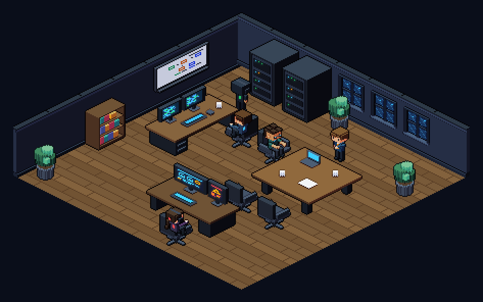

<sub>Every pixel above is rendered by this repo from <a href="assets/office-starter/sample-office.room.json"><code>sample-office.room.json</code></a>. No hand-drawn sprites.</sub>

</div>

Asking an image model for isometric sprites gives you wobbly angles, a different scale for every
asset, and no way to turn an object around. iherk-pixcel takes the other route: describe the object
once as a small voxel model, then let a deterministic software rasterizer draw it. The same input
always produces the same PNG, byte for byte, and all four facings come for free.

It ships as a TypeScript engine, a CLI (`pixcel`), an MCP server and a local web preview.

## Highlights

| | |
|---|---|
| 🧱 **Voxel DSL** | Write assets as `.pixcel.json`: `box`, `hollowBox`, `cylinder`, `slope`, `line`, `voxel`, `mirror`, plus pixel decals for screens and signs |
| ✂️ **Carve from 2D** | Turn 1–6 orthographic PNG views (front, side, top…) into an editable voxel model |
| 🧭 **Four directions & 360°** | Exact 90° tile-locked turns (`se`, `sw`, `nw`, `ne`) plus smooth 360° orthographic WebGL2 turntable and 8/16-dir export |
| 💡 **Pixel-art lighting** | Three-face shading ramps, voxel ambient occlusion, 1px outlines and an emissive glow pass |
| 🧍 **Rigged characters** | Parametric chibi agents with eight animation clips, built from a one-line spec |
| 🏢 **Room compositor** | Lay out floors, walls, furniture and characters in `.room.json`, sorted by topological depth |
| 📦 **Game-ready export** | PNG, sprite sheet, 360° GIF, sprite stack, OBJ+MTL, and a TexturePacker atlas with isometric metadata |
| 🤖 **Built for agents** | 12 MCP tools that return rendered previews, so an agent can look at its own work and fix it |

## One model, four directions

Author the front once. Each direction is the same voxel grid rotated a quarter turn, so nothing
drifts between facings.

<table>
<tr>
<td align="center">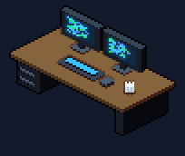</td>
<td align="center">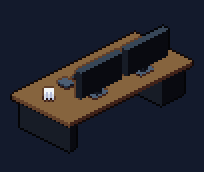</td>
<td align="center">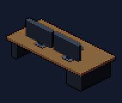</td>
<td align="center">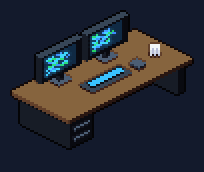</td>
</tr>
<tr>
<td align="center"><code>se</code></td>
<td align="center"><code>sw</code></td>
<td align="center"><code>nw</code></td>
<td align="center"><code>ne</code></td>
</tr>
</table>

## Smooth 360° turntable

Need arbitrary angles, 8/16-direction sprites, or a spinning showcase? `pixcel preview` opens a
60 FPS WebGL2 orthographic viewport where you can drag to orbit 360° smoothly, toggle
**PIXELART ↔ 3D SMOOTH**, snap to 8 isometric directions or flat orthographic views (`FR`/`RS`/`BK`/`LS`/`TOP`),
play character clips while spinning, and export a 360° GIF in one click.

<table>
<tr>
<td align="center">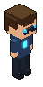</td>
<td align="center">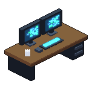</td>
</tr>
<tr>
<td align="center"><code>pixcel turntable agent-dev --frames 36 --format gif</code></td>
<td align="center"><code>pixcel turntable desk-dev-dual --frames 36 --format gif</code></td>
</tr>
</table>

## Characters

`create-character` builds a rigged chibi agent from a short spec: hair, outfit, colours, glasses,
headset. Every character gets the same eight clips.

<table>
<tr>
<td align="center"></td>
<td align="center">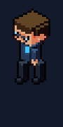</td>
<td align="center">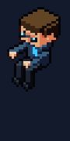</td>
<td align="center">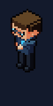</td>
<td align="center">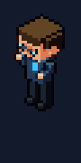</td>
<td align="center">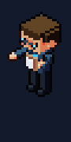</td>
<td align="center">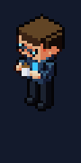</td>
<td align="center">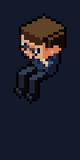</td>
</tr>
<tr>
<td align="center"><code>idle</code></td>
<td align="center"><code>walk</code></td>
<td align="center"><code>sit_type</code></td>
<td align="center"><code>inspect</code></td>
<td align="center"><code>talk</code></td>
<td align="center"><code>assign</code></td>
<td align="center"><code>rest_coffee</code></td>
<td align="center"><code>rest_sleep</code></td>
</tr>
</table>

Five starter agents live in [`assets/characters/`](assets/characters/):

<table>
<tr>
<td align="center">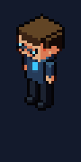</td>
<td align="center">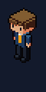</td>
<td align="center">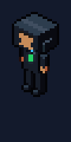</td>
<td align="center">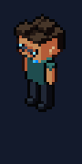</td>
<td align="center">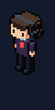</td>
</tr>
<tr>
<td align="center"><code>agent-dev</code></td>
<td align="center"><code>agent-pm</code></td>
<td align="center"><code>agent-operator</code></td>
<td align="center"><code>agent-automation</code></td>
<td align="center"><code>agent-security</code></td>
</tr>
</table>

## Quick start

**Requirements:** Node.js ≥ 22. Image encoding is pure JavaScript, so there is nothing native to compile.

```bash
git clone https://github.com/pakornpong/iherk-pixcel.git
cd iherk-pixcel
npm install
npm run build
npm link          # optional: puts the `pixcel` command on your PATH
```

Without `npm link`, use `node dist/cli/index.js` wherever the examples say `pixcel`.

```bash
# Render the sample office
pixcel render-room assets/office-starter/sample-office.room.json --out out/office.png

# Render one asset: four directions, packed sheet + atlas
pixcel render assets/office-starter/desk-dev-dual.pixcel.json --out out/desk

# Make a character and export its walk cycle as a GIF
pixcel create-character --id agent-nova --hair ponytail --outfit blazer --glasses
pixcel render assets/characters/agent-nova.pixcel.json --animation walk --directions se --format gif --out out/nova

# Export a smooth 360° turntable GIF or 16-direction sprite atlas
pixcel turntable agent-dev --frames 36 --pitch 30 --fps 18 --format gif --out out/turntable
pixcel turntable agent-dev --frames 16 --format atlas --out out/turntable

# Open the 60 FPS WebGL2 360° Turntable, 2:1 Iso Inspector & Office Sandbox
pixcel preview
```

`pixcel preview` opens on **http://127.0.0.1:4173** (change it with `--port`).

### Dev and build

There is no server to deploy. The only difference is whether you run the TypeScript source or the
compiled output.

| | Dev | Built |
|---|---|---|
| Command | `npm run dev -- <command>` (runs `src/` through `tsx`) | `npm run build`, then `pixcel <command>` |
| Code that runs | `src/cli/index.ts` | `dist/cli/index.js` |
| Preview URL | http://127.0.0.1:4173 | http://127.0.0.1:4173 |
| MCP server and downstream projects | not used | read `dist/`, so rebuild after editing `src/core` |

## Authoring an asset

An asset is a list of materials and a list of voxel operations. This is the whole potted plant:

```jsonc
{
  "schemaVersion": 1,
  "id": "plant-potted",
  "layer": "object",                 // floor | wall | wall-decor | object
  "outlineMode": "silhouette",       // silhouette | none | top-only
  "tilePreset": "64x32",             // 64x32 | 64x31 | 32x16
  "voxelsPerTile": 32,
  "footprintTiles": [1, 1],
  "materials": {
    "pot":         { "color": "#3c4659", "kind": "matte" },
    "leaf_mid":    { "color": "#2d6a4f", "kind": "matte" },
    "leaf_bright": { "color": "#52b788", "kind": "matte" }
  },
  "ops": [
    { "op": "cylinder", "center": [16, 16], "zFrom": 0,  "zTo": 8,  "radius": 5, "material": "pot" },
    { "op": "cylinder", "center": [15, 17], "zFrom": 18, "zTo": 24, "radius": 6, "material": "leaf_mid" },
    { "op": "box", "from": [19, 18, 17], "to": [22, 21, 21], "material": "leaf_bright" }
  ]
}
```

Material kinds are `matte`, `wood`, `metal`, `glass` and `emissive`. Colours come from the asset's
own `materials`; the shading ramp for each face is derived from that colour. Palettes are used by
the carver to snap imported pixels to a fixed set of colours.

Got a sprite already? Carve it into voxels instead:

```bash
pixcel carve --front front.png --side side.png --top top.png --id lamp --out assets/lamp.pixcel.json
```

### Starter pack

Twelve office assets in [`assets/office-starter/`](assets/office-starter/) double as reference
templates.

<div align="center">
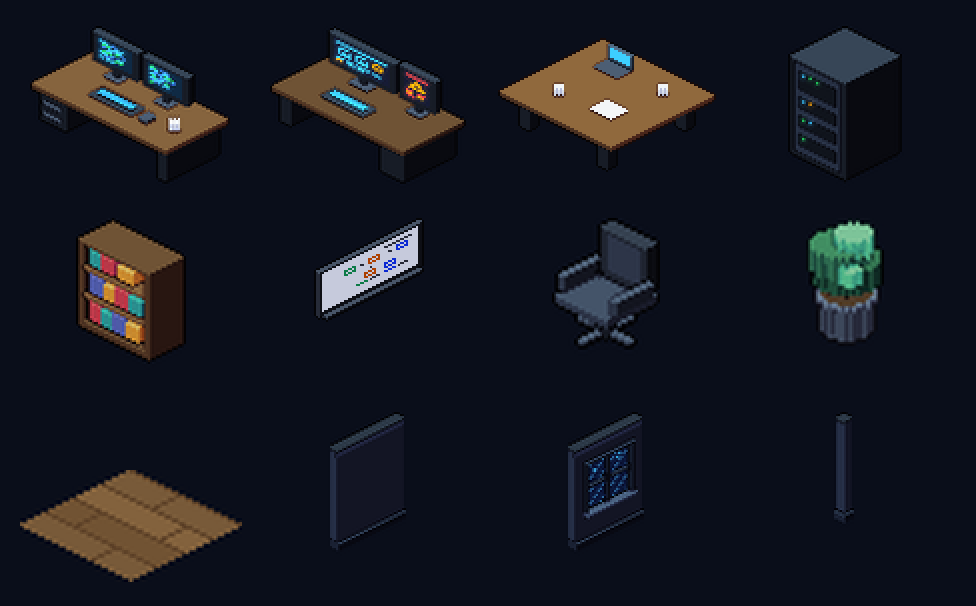
</div>

## How it works

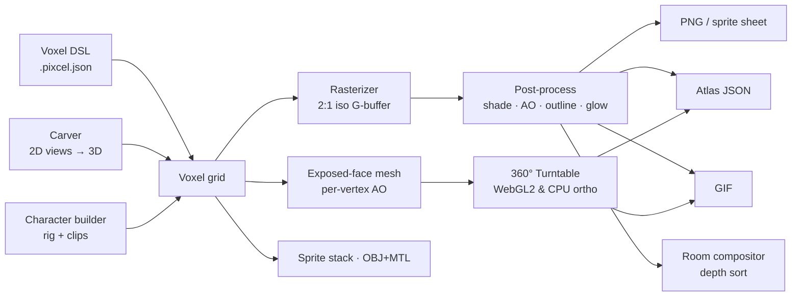

### Emissive light as its own layer

Screens, LEDs and neon are marked `emissive`. Export them baked into the sprite, or as a separate
`_emissive.png` so your game can dim the room and keep the screens lit.

<table>
<tr>
<td align="center">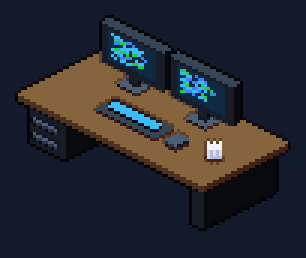</td>
<td align="center">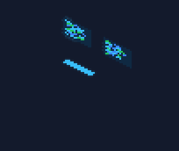</td>
<td align="center">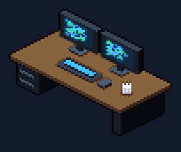</td>
</tr>
<tr>
<td align="center"><sub>Base sprite (<code>--emissive split</code>)</sub></td>
<td align="center"><sub>Emissive layer</sub></td>
<td align="center"><sub>Baked (<code>--emissive baked</code>)</sub></td>
</tr>
</table>

### Atlas metadata

The atlas is TexturePacker JSON Hash, so PixiJS and Phaser load it as is. Each frame also carries
what an isometric scene needs to place and sort it:

```jsonc
"desk-dev-dual/se/idle_0": {
  "frame": { "x": 2, "y": 2, "w": 94, "h": 78 },
  "pivot": { "x": 0.6596, "y": 0.9615 },
  "isometric": {
    "direction": "se",
    "durationMs": 550,
    "layer": "object",
    "footprintTiles": [2, 1],
    "anchor": { "x": 62, "y": 75 }   // pixel to pin onto the tile's ground point
  }
}
```

## CLI

```text
pixcel validate <asset.pixcel.json>
pixcel create-character --id <name> [--hair short|spiky|bob|ponytail|parted|hood_up]
                        [--outfit hoodie|blazer|tshirt|sweater] [--glasses] [--headset] [--out file]
pixcel render <asset> [--out dir] [--directions se,sw,nw,ne]
                      [--animation idle|walk|sit_type|inspect|talk|assign|rest_coffee|rest_sleep|all]
                      [--format png|atlas|gif|stack|obj] [--emissive baked|split|both]
pixcel turntable <asset> [--out dir] [--frames 36] [--pitch 30] [--yaw deg] [--fps 18]
                         [--format gif|atlas|png] [--animation idle] [--outline silhouette|none]
                         [--light camera|world]
pixcel carve --front front.png [--side side.png] [--top top.png] --id <name> --out <asset.pixcel.json>
             [--palette office-night] [--depth 4]
pixcel pack <asset-or-dir...> --out <dir> [--name office-atlas] [--emissive both]
pixcel render-room <room.json> --out <room.png> [--frame 0] [--emissive baked|split|both]
pixcel palette list | show <name>
pixcel preview [--port 4173] [--root .]
pixcel mcp [--root .]
```

## MCP server

`pixcel mcp` is a local stdio server. Register it once and any MCP client can author and render
assets:

```bash
claude mcp add pixcel --scope user -- node /absolute/path/to/iherk-pixcel/dist/cli/index.js mcp --root /absolute/path/to/iherk-pixcel
```

| Tool | What it does |
|---|---|
| `list_assets` · `read_asset` | Browse the workspace and the starter pack |
| `create_asset` · `update_asset` | Write and validate `.pixcel.json` assets |
| `carve_from_views` | Carve a voxel model from 1–6 orthographic PNG views |
| `create_character` | Build a rigged chibi agent with all eight clips |
| `render_asset` | Render to PNG, atlas, GIF, sprite stack or OBJ+MTL, with an inline preview image |
| `render_turntable` | Render 8/16-direction sprites or a smooth 360° turntable GIF / atlas at any pitch |
| `render_room` | Composite a `.room.json` layout into one PNG |
| `pack_atlas` | Pack several assets into one sheet and `.atlas.json` |
| `list_palettes` · `get_palette` | Inspect the available colour palettes |

Render tools return the image along with the file path, so the agent sees the result and can
correct its own model without a human in the loop.

## Project layout

```text
src/
  core/         voxel grid, DSL compiler, carver, 2:1 iso rasterizer, 360° turntable
                mesh builder & rasterizer, post-process, character builder, room compositor, exporters
  cli/          the `pixcel` command
  mcp/          MCP server (12 tools)
  preview/      local web preview (WebGL2 360° Turntable + Canvas 2D Inspector & Sandbox)
assets/
  office-starter/   12 furniture, floor and wall assets + sample-office.room.json
  characters/       5 starter agents
  palettes/         office-night, office-day
docs/           design specs and README images
tests/          vitest suites (47 tests)
```

```bash
npm test          # run the test suite
npm run build     # compile to dist/
```

## Used by

[**IHERK Hell Factory**](https://github.com/pakornpong/iherk-hell-factory) is a live isometric
office where AI coding agents show up for work. It imports this engine's compiled core from
`dist/core/` to build its sprite atlases, so run `npm run build` here after changing `src/core`.

---

<div align="center">
<sub>Clean-room implementation: original TypeScript and original starter assets.<br>
Design notes live in <a href="docs/superpowers/specs/2026-11-24-iherk-pixcel-design.md"><code>docs/superpowers/specs/</code></a>.</sub>
</div>
